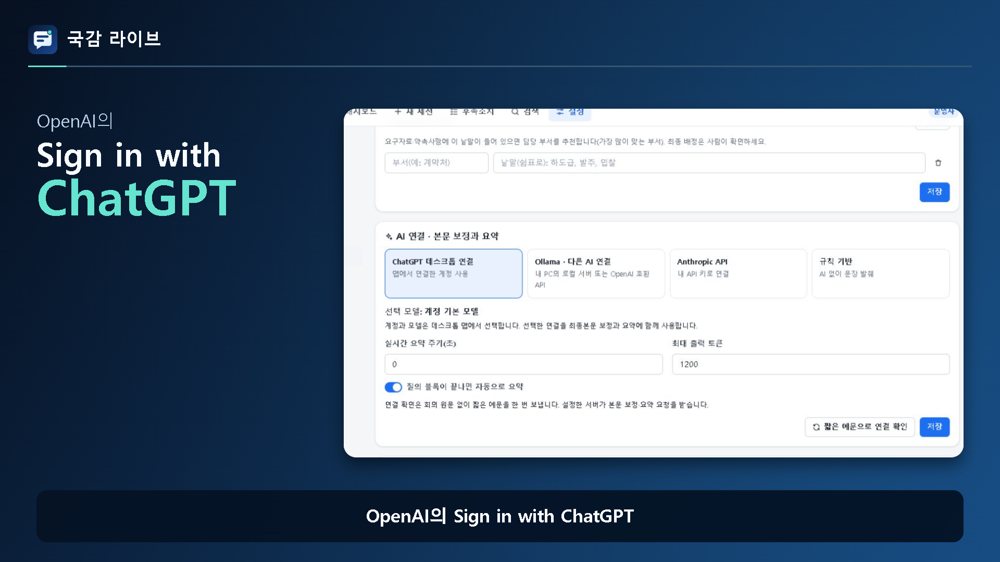

# 국감 라이브 데스크톱

**바이브코딩 몰라도 내 GPT 계정으로 국정감사 회의록 정리**

[Windows 설치파일](https://github.com/Kminer2053/gukgam-live-desktop/releases/download/v0.1.0/Gukgam-Live-Setup-0.1.0.exe) · [그림으로 보는 사용설명서](https://github.com/Kminer2053/gukgam-live-desktop/releases/download/v0.1.0/Gukgam-Live-Manual-ko.html) · [Threads 세로형 영상](https://github.com/Kminer2053/gukgam-live-desktop/releases/download/v0.1.0/Gukgam-Live-Introduction-9x16.mp4)

국감 때 사용한 **감사 질의 기록·중계 시스템**을 일반 사무담당자도 편하게 쓸 수 있는 Windows 앱으로 만들었습니다. 코딩을 배우거나 개발 도구를 설치할 필요가 없습니다.

**Sign in with ChatGPT**로 내 ChatGPT 구독 계정을 연결해 AI 기능을 사용할 수 있습니다. 복잡한 API 키 입력이나 로컬 AI 설정 없이 시작하세요. 이용 가능한 기능과 사용량은 본인 계정의 조건을 따릅니다. [OpenAI의 기능 안내](https://developers.openai.com/siwc/token-sharing-open-source)

## 처음에는 이것만 하세요

1. **설치하고 기관명을 입력합니다.** Windows 설치파일을 실행하고, 앱에 우리 기관 이름을 저장하세요.
2. **내 ChatGPT를 연결합니다.** 시작 화면의 **AI 연결**에서 로그인하세요.
3. **기록할 회의를 고릅니다.** **기록 화면 열기**를 누르고 회의를 선택해 기록을 시작하세요.

설치 후 시작 화면의 **설치·활용 매뉴얼**을 누르면 그림과 실제 화면으로 사용법을 볼 수 있습니다. ChatGPT 연결 전에도 회의 기록부터 시작할 수 있습니다.

## 긴 회의를 다시 찾고, 요점부터 읽으세요

| 필요한 일 | 이렇게 쓰세요 |
|---|---|
| 특정 발언 찾기 | 검색칸에 단어를 입력하면 관련 발언이 표시됩니다. |
| 원하는 대목으로 이동 | 화면 아래 시간 막대를 움직이면 그 시각의 발언으로 이동합니다. |
| 질문한 사람별 요점 보기 | **위원별**에서 질의를 펼치면 질문·답변의 요약을 볼 수 있습니다. |
| 자료 요구·제출 약속 챙기기 | **후속조치**에서 담당 부서·기한·처리 상태를 관리합니다. |
| 우리 기관 관련 발언 찾기 | 기관 이름·별칭·관심 단어가 나오면 표시해 줍니다. |
| 보고서로 전달하기 | 정리한 기록을 문서·단독 HTML 등으로 내보냅니다. |

국회에서 제공하는 자막으로 기록하거나, 보관한 녹음·녹화 파일을 불러올 수 있습니다. 녹음 파일은 장비와 파일 길이에 따라 처리 시간이 더 걸릴 수 있습니다.

## 동료와 공유할 때만 중계를 켜세요

시작 화면의 **릴레이 열람 준비** 안내에 따라 동료가 볼 사이트를 연결합니다. 기록 화면의 **설정 → 중계 서비스**에서 사용할 날짜를 정하고 켜세요.

- **시작일·종료일을 선택하고 저장합니다.** 한국시간 기준으로 종료일까지 중계합니다.
- **사용이 끝나면 체크를 끄고 저장합니다.** 동료에게 보내는 중계 연결이 멈춥니다.
- **내 PC의 기록은 계속 사용할 수 있습니다.** 중계가 꺼져도 수집·검색·AI 정리를 사용할 수 있습니다.

동료가 기록을 보려면 원본 PC와 앱이 켜져 있어야 합니다. 중계 사이트·저장소의 이용 요금은 별도로 남을 수 있습니다. 기존 버전에서 운영 기간을 정하지 않았다면 새 설정에서 기간을 확인하고 켜 주세요.

## 설치와 기록 보관

Windows 10/11 **64비트**, Core i5급·메모리 16GB를 기준으로 준비했습니다. 일반 사용자는 Python·Node.js·Git을 설치하지 않습니다.

회의 기록은 내 PC의 앱 전용 폴더에 저장합니다. 사람이 고친 내용은 자동 정리로 덮어쓰지 않는 구조입니다. 필요한 기록은 보고서나 단독 HTML로 따로 보관하세요. 설정한 보존 기간이 지나거나 회의를 삭제하면 관련 자료가 정리될 수 있습니다.

**정식 0.1.0** 설치파일·영상·설명서와 파일 확인값은 [GitHub Releases](https://github.com/Kminer2053/gukgam-live-desktop/releases/tag/v0.1.0)에서 받으세요.

다른 AI를 쓰고 싶은 경우

설정에서 Ollama·LM Studio·OpenAI API 또는 호환 서비스를 선택할 수 있습니다. 이미 사용하는 서버·모델·키가 있는 분을 위한 선택 기능입니다. 기본 사용에 필요하지 않습니다.

ChatGPT 구독 사용과 API 이용 요금은 별개입니다. 외부 AI를 고르면 정리에 필요한 글이 해당 서비스로 전달됩니다. 녹음 전사·목소리 구분에는 Nemotron CPU 기능을, 추가 역할 판정에는 선택 기능인 Julia-1을 사용합니다. 자세한 준비 방법은 사용설명서의 고급 안내에서 확인하세요.

개발·배포 자료와 라이선스

- [HTML 사용설명서 소스](docs/public-release/manual.html)
- [앱 소개](docs/public-release/RELEASE_OVERVIEW.md)
- [공개 파일 범위](docs/public-release/EXPORT_REVIEW.md)
- [배포 확인 정보](docs/public-release/RELEASE_MANIFEST.json)
- [제삼자 코드·모델 고지](docs/public-release/THIRD_PARTY_NOTICES.md)

프로젝트 소스는 [MIT 라이선스](LICENSE)로 공개합니다. 모델과 외부 라이브러리에는 개별 라이선스가 적용됩니다. 실제 회의 기록·녹음·사용자 계정·개인 설정은 공개 소스에 포함하지 않습니다.

[GitHub](https://github.com/Kminer2053/gukgam-live-desktop) · [공공 GitLab](https://gitlab.aigov.go.kr/Kminer2053/gukgam-live-desktop). 각 저장소의 게시 상태는 배포 확인 정보에 기록합니다.

