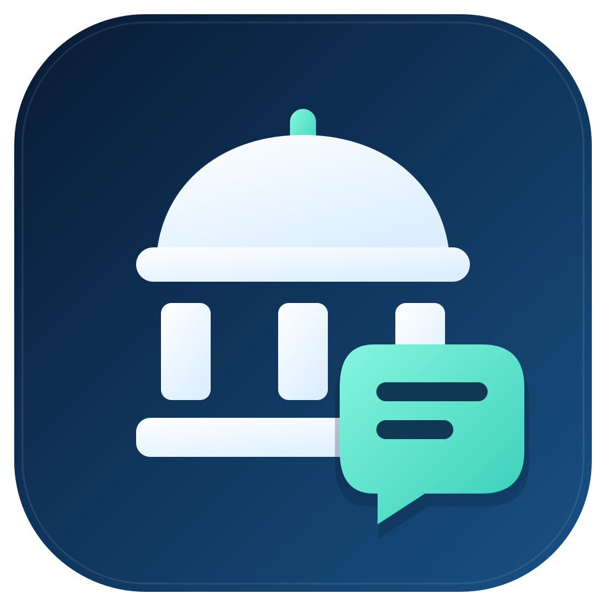
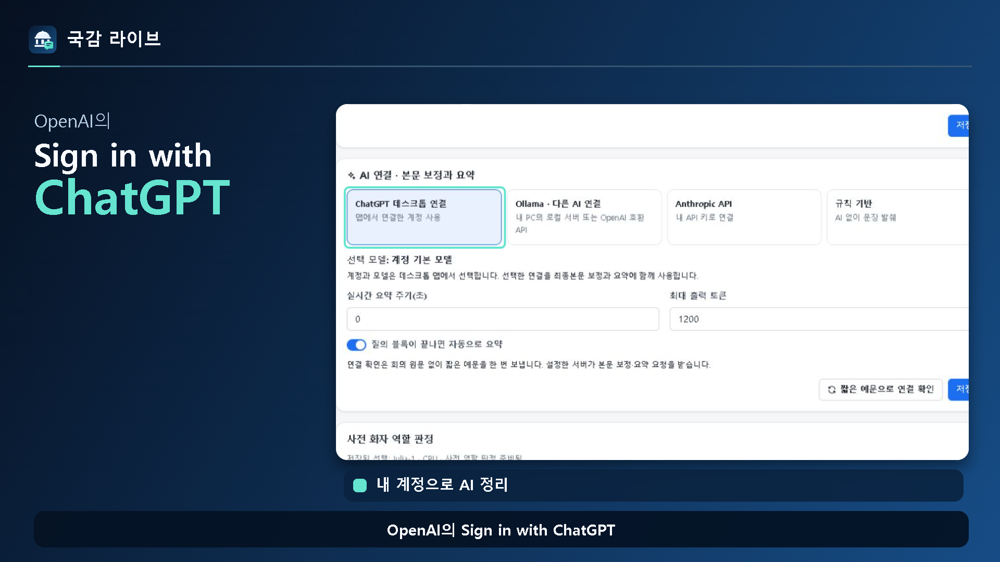

# 국감 라이브 데스크톱

**바이브코딩 몰라도 내 GPT 계정으로 국정감사 회의록 정리**

[공식 다운로드·변경사항](https://github.com/Kminer2053/gukgam-live-desktop/releases) · [그림으로 보는 사용설명서](docs/public-release/manual.html) · [Threads 세로형 영상](https://github.com/Kminer2053/gukgam-live-desktop/releases/download/v0.1.0/Gukgam-Live-Introduction-9x16-Structure.mp4)

국감 때 사용한 **감사 질의 기록·중계 시스템**을 일반 사무담당자도 편하게 쓸 수 있는 Windows 앱으로 만들었습니다. 코딩을 배우거나 개발 도구를 따로 설치할 필요가 없습니다.

**0.2.0 경량 인터넷 설치판을 공개했습니다.** [설치파일 받기](https://github.com/Kminer2053/gukgam-live-desktop/releases/download/v0.2.0/Gukgam-Live-Setup-0.2.0.exe) · [배포 안내](https://github.com/Kminer2053/gukgam-live-desktop/releases/tag/v0.2.0). 설치파일은 0.77MB이며, 설치 중 받는 기본 앱까지 합해 최초 약 114.8MB입니다. 필요한 도구는 처음 쓸 때 받아 두고 다시 사용합니다.

**Sign in with ChatGPT**로 내 ChatGPT 구독 계정을 연결할 수 있습니다. 별도 API 키나 로컬 AI 프로그램 준비 없이 시작하세요. 이용 가능한 기능과 사용량은 본인 계정·플랜·서비스 정책을 따릅니다. [OpenAI의 기능 안내](https://developers.openai.com/siwc/token-sharing-open-source)

## 처음에는 네 가지만 하세요

1. **설치하고 기관명을 입력하세요.** 인터넷에 연결한 채 설치파일을 실행하면 기본 앱 파일을 받습니다.
2. **내 ChatGPT를 연결하세요.** 시작 화면의 **AI 연결**에서 로그인하세요.
3. **기록할 회의를 고르세요.** **기록 화면 열기**를 처음 누르면 기록 도구를 받습니다. 준비가 끝나면 회의를 선택하고 시작하세요.
4. **검색하고 요약을 읽으세요.** 자료 요구·약속을 챙긴 뒤 보고서로 내보내세요.

설치 후 시작 화면의 **설치·활용 매뉴얼**을 누르면 그림과 실제 화면으로 따라 할 수 있습니다. ChatGPT 연결 전에도 회의 기록부터 시작할 수 있습니다.

## 필요한 기능만 준비하세요

| 누르는 기능 | 처음 준비할 내용 |
|---|---|
| 앱 설치 | 시작 화면과 계정 연결에 필요한 기본 앱 |
| 기록 화면 열기 | 자막·파일 기록과 검색·보고서에 필요한 기록 도구 |
| 중계 연결·사이트 준비 | 중계 도구와 사이트 기본 자료. 중계를 쓰지 않으면 받지 않습니다. |
| 녹음 기록·목소리 구분 | 사용 조건을 확인하고 음성 기능을 준비합니다. |
| 추가 역할 판정 | Julia-1을 선택한 경우에만 별도로 준비합니다. |

기능별 첫 준비 화면에서 받을 용량과 진행 상태를 확인하세요.

**국회 자막만 기록할 때는 음성 모델을 받을 필요가 없습니다.** 한 번 검증해 둔 파일은 다시 사용하며, 업데이트로 새 판본이 필요할 때는 다시 받을 수 있습니다. 준비를 취소했다면 인터넷 연결을 확인하고 다시 시도하세요. 기존 회의 기록은 준비 파일과 따로 보관합니다.

설치와 첫 준비에는 인터넷이 필요합니다. 이후에도 국회 자막 수신·ChatGPT 정리·동료 중계는 인터넷 연결이 필요합니다. 파일을 받아 둔다고 모든 기능이 오프라인으로 바뀌지는 않습니다.

## 긴 회의를 다시 찾고, 요점부터 읽으세요

| 필요한 일 | 이렇게 쓰세요 |
|---|---|
| 특정 발언 찾기 | 검색칸에 단어를 입력하면 관련 발언이 표시됩니다. |
| 원하는 대목으로 이동 | 화면 아래 시간 막대로 그 시각의 발언으로 이동합니다. |
| 질문한 사람별 요점 보기 | **위원별**에서 질의를 펼쳐 각 질문·답변의 요약을 읽습니다. |
| 자료 요구·제출 약속 챙기기 | **후속조치**에서 담당 부서·기한·처리 상태를 관리합니다. |
| 우리 기관 관련 발언 찾기 | 기관 이름·별칭·관심 단어가 나오면 표시해 줍니다. |
| 보고서로 전달하기 | 정리한 기록을 문서·단독 HTML 등으로 내보냅니다. |

보관한 녹음·녹화 파일도 불러올 수 있습니다. 음성 처리는 PC 성능과 파일 길이에 따라 오래 걸릴 수 있습니다. 화면 아래 시간 막대는 기록 발언을 찾는 기능입니다.

## 동료와 공유할 때만 중계를 켜세요

시작 화면의 **릴레이 열람 준비**에서 실제 연결·준비 버튼을 누를 때 필요한 도구를 받습니다. 혼자 기록하면 이 단계는 건너뛰세요.

사이트를 연결했다면 기록 화면의 **설정 → 중계 서비스**에서 사용할 시작일·종료일을 정하고 켜세요. 한국시간으로 종료일까지 중계합니다. 사용이 끝나면 체크를 끄고 저장하세요. 중계가 꺼져도 내 PC의 수집·기록·검색·AI 정리는 계속 사용할 수 있습니다.

동료가 기록을 보려면 원본 PC와 앱이 켜져 있고 인터넷에 연결돼 있어야 합니다. 중계 사이트·저장소의 이용 요금은 별도로 남을 수 있습니다.

## 설치와 기록 보관

Windows 10/11 **64비트**, Core i5급·메모리 16GB를 기준으로 준비합니다. 일반 사용자는 Python·Node.js·Git을 설치하지 않습니다.

회의 기록은 내 PC의 앱 전용 폴더에 저장합니다. 사람이 고친 내용은 자동 정리로 덮어쓰지 않는 구조입니다. 필요한 기록은 보고서나 단독 HTML로 따로 보관하세요. 설정한 보존 기간이 지나거나 회의를 삭제하면 관련 자료가 정리될 수 있습니다.

다른 AI를 쓰고 싶은 경우

설정에서 Ollama·LM Studio·OpenAI API 또는 호환 서비스를 선택할 수 있습니다. 이미 사용하는 서버·모델·키가 있는 분을 위한 선택 기능이며 기본 사용에 필요하지 않습니다.

ChatGPT 구독 사용과 API 이용 요금은 별개입니다. 외부 AI를 고르면 정리에 필요한 글과 문맥이 해당 서비스로 전달됩니다. 음성 전사·목소리 구분과 추가 역할 판정은 별도로 준비하는 선택 기능입니다. 모델의 사용 조건과 PC 여유 공간을 확인하세요.

개발·배포 자료와 라이선스

- [HTML 사용설명서 소스](docs/public-release/manual.html)
- [앱 소개](docs/public-release/RELEASE_OVERVIEW.md)
- [제품 구성과 보존 계약](docs/DESKTOP_PRODUCT.md)
- [설치파일·선택 다운로드 구성](docs/INSTALLER_SIZE.md)
- [공개 파일 범위](docs/public-release/EXPORT_REVIEW.md)
- [배포 확인 정보](docs/public-release/RELEASE_MANIFEST.json)
- [제삼자 코드·모델 고지](docs/public-release/THIRD_PARTY_NOTICES.md)
- [개발용 Python 의존성 고정](docs/PYTHON_DEPENDENCY_LOCKS.md)
- [기존 기록의 중복 판정 키 이전](docs/ITEM_FINGERPRINT_MIGRATION.md)

정식 0.2.0의 소스·설치파일·선택 구성요소는 GitHub에 공개했습니다. 공공 GitLab에는 새 의존성 4파일이 보안 검사 5종을 통과했지만, 나머지 소스 반영은 검사 결과 없는 HTTP 502로 미완료입니다. 최신 전체 소스는 GitHub를 이용하세요. 각 저장소의 확인 시점과 범위는 배포 확인 정보에 기록합니다.

개발 환경은 Windows x64·Node.js 24와 고정된 Python 의존성을 사용합니다. 고정 의존성 준비·호환 보완 → Python 엔진 빌드 → scripts/build_runtime_packs.py로 선택 다운로드와 고정 카탈로그 생성 → 데스크톱 빌드 → nsis-web 패키징 순서입니다. 사용자의 PC에서 npm을 실행하거나 소스를 다시 빌드하지 않습니다.

인터넷 설치는 electron-builder 26.18.0의 원본 NSIS 템플릿 두 곳을 desktop/scripts/apply-web-installer-security.cjs로 보완합니다. 기본 앱 압축 자료를 기존판 종료·제거 전에 소유한 임시 사본으로 준비하고 SHA512를 확인하며 추출 직전에도 재확인합니다. 원본·패치 후 SHA가 고정돼 있고 원 패키지 선언·lock·라이선스를 바꾸지 않습니다. 개발자는 desktop에서 node scripts/apply-web-installer-security.cjs로 적용할 수 있으며 배포 준비 단계에서도 실행합니다. 실제 설치 검증과 최종 용량은 별도 확인 대상입니다.

선택 다운로드의 주소·크기·해시·파일 목록은 앱 빌드에 고정합니다. 새 도구가 준비돼도 자동으로 회의 수집이나 모델 추론을 시작하지 않습니다.

프로젝트 소스는 [MIT 라이선스](LICENSE)로 공개합니다. 모델과 외부 라이브러리에는 개별 라이선스가 적용됩니다. 실제 회의 기록·녹음·사용자 계정·개인 설정은 공개 소스에 포함하지 않습니다.

[GitHub](https://github.com/Kminer2053/gukgam-live-desktop) · [공공 GitLab](https://gitlab.aigov.go.kr/Kminer2053/gukgam-live-desktop)

