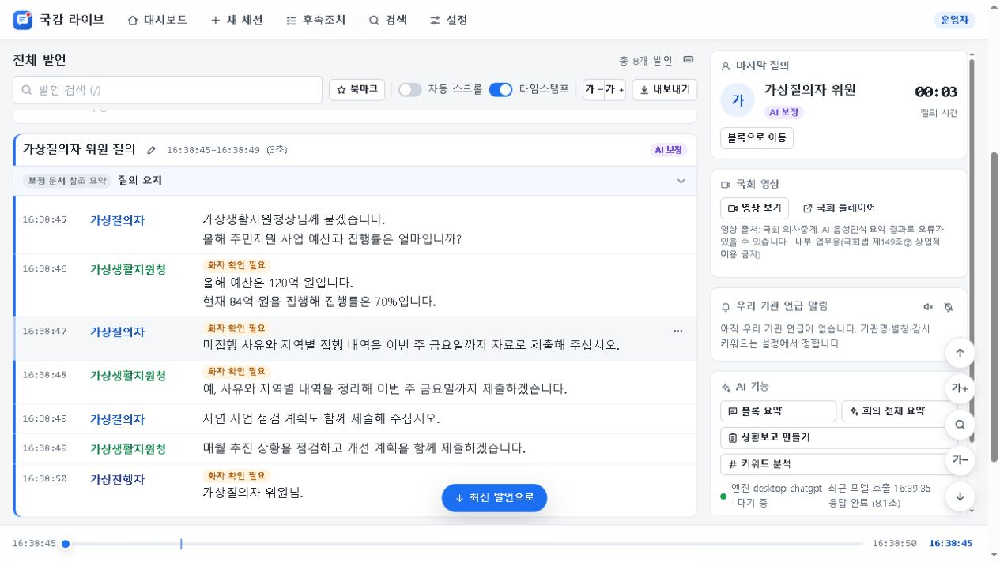

# 국감 라이브 데스크톱

**바이브코딩 몰라도 내 GPT 계정으로 국정감사 회의록 정리**

필요한 발언을 검색하고, 하단 시간바로 기록을 오가고, 질의 요약과 자료 요구·약속을 한곳에서 정리하는 Windows 앱입니다.

Windows x64 · 발언 검색 · 시간바 탐색 · 질의 요약 · 자료 요구·약속 · 보고서

**[설치 안내](#windows-install) · [설치·활용 매뉴얼](docs/public-release/manual.html) · [소개영상](docs/public-release/media/gukgam-live-product-tour.mp4) · [GitHub](https://github.com/Kminer2053/gukgam-live-desktop)**

> **Windows preview.25 · 실제 화면으로 배우는 국감 기록 앱.** 설치파일·HTML 매뉴얼·홍보영상과 SHA-256은 [GitHub Releases](https://github.com/Kminer2053/gukgam-live-desktop/releases)에서 확인하세요. 프로젝트 소스코드는 [MIT 라이선스](LICENSE)로 제공합니다.

## 긴 회의에서 필요한 내용을 빠르게 찾으세요

발언 검색으로 관련 문장을 찾고, 화면 아래 시간바를 움직여 원하는 시각의 기록으로 이동하세요. 질의가 끝나면 생성된 요약을 질의자별·회차별로 모아 보고, 자료 요구와 약속은 후속조치 목록에서 이어서 관리할 수 있습니다.

## 한눈에 보기

| 하고 싶은 일 | 앱에서 하는 일 |
|---|---|
| 필요한 발언 찾기 | 전체 발언에서 단어를 검색하고 결과 건수와 해당 문장 확인 |
| 기록을 빠르게 오가기 | 하단 시간바를 클릭하거나 끌어 가까운 시각의 발언으로 이동 |
| 질의 요점 파악 | 질의 블록별 자동 요약을 질의자별·회차별로 모아 보기 |
| 자료 요구와 약속 챙기기 | 후속조치 목록에서 내용·담당 부서·기한·처리 상태 정리 |
| 보고서 만들기 | 기록을 단독 HTML·문서·텍스트·CSV로 내보내기 |
| 회의 기록 | 국회 AI자막 수신, 녹음·녹화 파일 전사, 수기 입력 |
| 우리 기관 기록 확인 | 기관명·별칭·관심어를 바탕으로 관련 발언 찾기 |
| 동료 열람 | 별도 기관 릴레이 사이트에서 연결된 PC의 기록 열람 |

## 쓰는 순서는 간단합니다

1. **내 계정을 연결합니다.** 기관명을 저장하고 데스크톱 앱의 **AI 연결**에서 ChatGPT 계정에 로그인합니다. Ollama·API를 선택하거나 AI 연결 전 기록부터 사용할 수도 있습니다.
2. **필요한 회의를 기록합니다.** 국회 자막이나 녹음 파일을 고르고 **시작**을 누릅니다. 앱 실행만으로 수집을 시작하지 않습니다.
3. **검색하고 시간바로 이동합니다.** 전체 발언의 검색칸에서 단어를 찾고, 검색을 비운 뒤 하단 시간바로 기록을 오갑니다.
4. **요약과 다음 할 일을 정리합니다.** **위원별**에서 질의 회차를 펼쳐 저장된 요약을 보고, **후속조치**에서 자료 요구와 약속을 정리한 뒤 보고서로 내보냅니다.

## AI를 선택할 수 있습니다

- **ChatGPT 계정:** 앱의 로그인 안내로 연결합니다. API 키 입력과 별개입니다.
- **Ollama·LM Studio:** 준비된 로컬 AI 서버와 모델을 연결합니다. 이 앱이 해당 서버나 모델을 자동 설치하는 것은 아닙니다.
- **OpenAI API·호환 서버:** 서버·모델·API 키를 별도로 설정합니다. 로컬 무인증 서버는 키 없이 연결할 수 있습니다.
- **AI 없이 기록:** 자막 수집·열람부터 사용하고 AI는 나중에 연결할 수 있습니다.

ChatGPT 계정 이용 조건과 API 요금은 별개입니다. 외부 서비스를 고르면 필요한 글과 문맥이 전송될 수 있습니다. 로컬 연결은 사용자가 준비한 서버·모델의 실행 환경을 따릅니다.

## 음성 전사와 역할 보정은 다른 단계입니다

| 구성 | 담당하는 일 |
|---|---|
| 국회 제공 자막 | 음성 모델 없이 원수신 글 기록 |
| Nemotron 3.5 ASR · CPU | 녹음을 글로 전사 |
| Nemotron 3 Diarization · CPU | 목소리별 발화 구간과 겹침 후보 구분 |
| Julia-1 · 선택 | 글의 질의·답변·진행·기타 역할 후보 판단 |
| 선택한 LLM | 전체 문맥의 역할·본문 보완과 요약 |

음성 전사·화자 구분·역할 보정은 각각의 단계입니다. 녹음은 CPU와 파일 조건에 따라 음성 길이보다 오래 처리될 수 있습니다. 필요한 모델의 준비 방법은 매뉴얼에서 확인하세요.

## Windows 설치

Windows 10/11 x64, Core i5급·메모리 16GB를 기준으로 준비합니다. 음성 CPU 기능은 AVX2와 모델·녹음·임시 변환 파일을 둘 저장공간이 필요합니다.

일반 사용자는 Python·Node.js·Git을 따로 설치하지 않습니다. [공식 릴리스](https://github.com/Kminer2053/gukgam-live-desktop/releases)에서 Windows 설치파일과 `SHA256SUMS.txt`를 확인하세요. **0.1.0-preview.25**는 실제 화면 10장을 넣은 매뉴얼을 포함합니다. 기록·보정 엔진과 화면 동작은 preview.24와 같습니다.

설치 후 시작 화면의 **설치·활용 매뉴얼**을 누르면 인터넷 없이 설명서를 볼 수 있습니다. 설치 전에는 [HTML 매뉴얼 원본](docs/public-release/manual.html)을 파일로 저장해 브라우저에서 여세요. GitHub에서는 HTML 소스가 먼저 표시될 수 있습니다.

## 앱 소개영상

[소개영상 보기](docs/public-release/media/gukgam-live-product-tour.mp4) · [포스터 보기](docs/public-release/media/poster-product-tour.png)

검색 결과를 찾아가는 장면, 하단 시간바로 발언을 오가는 장면, 질의자별로 모은 질의 요약을 실제 앱 화면으로 보여 줍니다. 자료 요구·약속 정리와 보고서 내보내기까지 이어지는 사용 흐름을 살펴보세요.

## 개인 기록과 공유

회의 기록은 이 PC의 앱 전용 저장소에 둡니다. 원문·수동 화자·사람이 수정하거나 검수한 결과는 자동 보정으로 덮어쓰지 않는 구조입니다. 앱 종료·업데이트·제거와 기록 삭제는 구분합니다.

설정한 보존 기간이 지나거나 회의를 삭제하면 관련 기록·원음·업로드 파일이 삭제될 수 있습니다. 단독 HTML 보관과 기관의 전체 백업 절차를 구분해 사용하세요. 릴레이는 별도 외부 서비스와 설정을 사용하며 PC가 꺼지면 원본 연결이 끊길 수 있습니다.

## 더 알아보기

- [설치·활용 HTML 매뉴얼](docs/public-release/manual.html)
- [앱 소개와 사용 방법](docs/public-release/RELEASE_OVERVIEW.md)
- [공개 범위와 제외 기준](docs/public-release/EXPORT_REVIEW.md)
- [배포 확인 메타데이터](docs/public-release/RELEASE_MANIFEST.json)
- [제삼자 고지](docs/public-release/THIRD_PARTY_NOTICES.md)

소스와 배포 소식은 [공식 GitHub 저장소](https://github.com/Kminer2053/gukgam-live-desktop)에서 안내합니다. [공공 GitLab](https://gitlab.aigov.go.kr/Kminer2053/gukgam-live-desktop)에도 공개 프로젝트를 준비했으며, 현재 게시 상태는 배포 확인 메타데이터에 기록합니다.

프로젝트 소스코드는 [MIT 라이선스](LICENSE)입니다. 모델·재사용 코드·의존성에는 [제삼자 고지](docs/public-release/THIRD_PARTY_NOTICES.md)에 적힌 개별 라이선스가 적용됩니다.
