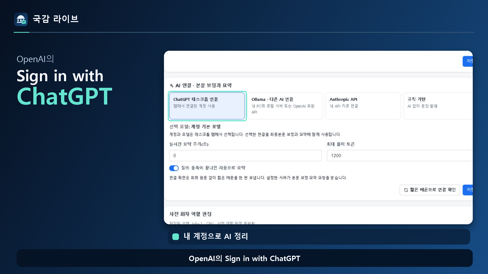

# 국감 라이브 데스크톱

**바이브코딩 몰라도 내 GPT 계정으로 국정감사 회의록 정리**

국감 때 사용한 감사 질의 기록·중계 시스템을 일반 사무담당자도 편하게 쓸 수 있는 Windows 앱으로 만들었습니다. 내 ChatGPT 구독 계정을 연결하면 복잡한 API 키 입력이나 로컬 AI 설정 없이 AI 정리를 시작할 수 있습니다.

## 처음 쓰는 순서

1. **설치하고 기관 이름을 저장하세요.** Python·Node.js 같은 개발 도구는 따로 설치하지 않습니다.
2. **시작 화면의 AI 연결에서 내 ChatGPT에 로그인하세요.** 사용 가능한 기능과 사용량은 본인 계정의 조건을 따릅니다.
3. **기록 화면을 열고 회의를 선택하세요.** 기록할 회의를 고른 뒤 시작합니다.
4. **검색하고 요약을 읽어 보세요.** 필요한 내용은 보고서로 내보냅니다.

어디를 눌러야 하는지는 [그림과 실제 화면이 있는 사용설명서](manual.html)에서 확인할 수 있습니다. 설치 후에는 시작 화면의 **설치·활용 매뉴얼**을 누르세요.

## 회의가 길어도 필요한 내용을 빠르게

| 필요한 일 | 쓰는 기능 |
|---|---|
| 특정 발언 찾기 | 단어 검색으로 관련 발언 확인 |
| 원하는 시각으로 이동 | 화면 아래 시간 막대를 움직여 발언 탐색 |
| 질문한 사람별 요점 보기 | **위원별**에서 질의를 펼쳐 질문·답변 요약 확인 |
| 다음 할 일 챙기기 | **후속조치**에서 자료 요구·제출 약속·기한 관리 |
| 보고서 만들기 | 문서·단독 HTML 등으로 내보내 보관·전달 |

## 공유할 때만 중계하세요

동료가 볼 사이트를 연결한 뒤 **설정 → 중계 서비스**에서 시작일·종료일을 정하고 켜세요. 한국시간으로 종료일까지 중계합니다. 사용이 끝나면 체크를 끄고 저장하면 됩니다. 내 PC의 수집·기록·AI 정리는 계속 사용할 수 있습니다.

동료가 기록을 보려면 원본 PC와 앱이 켜져 있어야 합니다. 중계 사이트·저장소 이용 요금은 별도로 남을 수 있습니다.

## 내려받기

[정식 0.1.2 설치파일·설명서·영상](https://github.com/Kminer2053/gukgam-live-desktop/releases/tag/v0.1.2) · [Threads 세로형 영상](https://github.com/Kminer2053/gukgam-live-desktop/releases/download/v0.1.0/Gukgam-Live-Introduction-9x16-Structure.mp4)

Windows 10/11 64비트, Core i5급·메모리 16GB를 기준으로 준비했습니다. 녹음 파일은 장비와 파일 길이에 따라 처리 시간이 더 걸릴 수 있습니다.

회의 기록은 PC의 앱 전용 폴더에 저장합니다. 필요한 기록은 보고서나 단독 HTML로 따로 보관하세요. 보존 기간 설정이나 회의 삭제에 따라 관련 자료가 정리될 수 있습니다.

다른 AI 연결과 관리자용 안내는 사용설명서 뒤쪽에서 확인할 수 있습니다. ChatGPT 구독과 API 이용 요금은 별개이며, 외부 AI를 선택하면 정리에 필요한 글이 해당 서비스로 전달됩니다. [OpenAI의 Sign in with ChatGPT 안내](https://developers.openai.com/siwc/token-sharing-open-source)

소스는 [MIT 라이선스](../../LICENSE)로 공개하며 모델과 외부 라이브러리는 [개별 라이선스](THIRD_PARTY_NOTICES.md)를 따릅니다. [GitHub](https://github.com/Kminer2053/gukgam-live-desktop) · [공공 GitLab](https://gitlab.aigov.go.kr/Kminer2053/gukgam-live-desktop) · [배포 확인 정보](RELEASE_MANIFEST.json)
